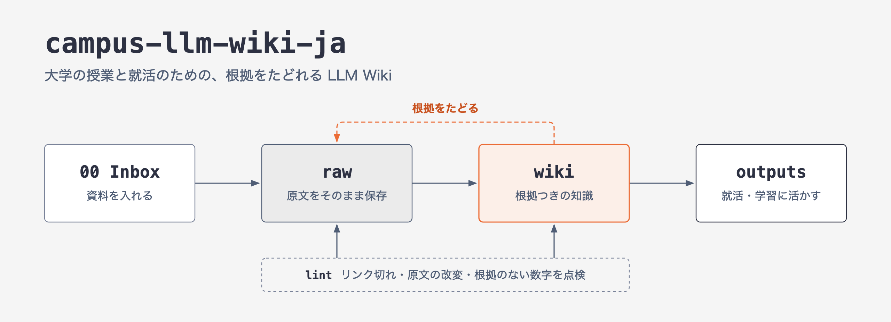

# campus-llm-wiki-ja

**大学の授業と就活のための、根拠をたどれる LLM Wiki（Obsidian + AI エージェント）**

授業のメモ、論文、記事、説明会の記録を `00 Inbox` に入れて「新しい資料を整理して」と頼むと、AI エージェント（Claude Code や Codex）が原文を `raw/` に保存し、根拠つきの Wiki ページにまとめ、索引を更新します。整理した知識は、授業の理解や就活の準備に役立ちます。

「AI に要約させて終わり」にしないための仕組みです。

- **原文は変えない** — 取り込んだ資料は `raw/` に登録し、SHA-256 で変化を検出します。
- **主張には根拠を** — 数字・日付・引用の横に、原文のどこかを書きます。
- **事実・AI の解釈・未確認を分ける** — `AI解釈:`、`要確認:` と書き分けます。
- **点検できる** — 標準ライブラリだけの Python スクリプトで、リンク切れ・frontmatter・原文の改変・根拠のない数字を点検します。

## こんな人向け

- 授業ノートや試験対策を一か所にまとめ、学習に役立てたい大学生
- 企業研究など就活の準備に、根拠のある情報を役立てたい人
- ゼミ・研究の資料や、興味で集めた記事を再利用できる形で残したい人

## 必要なもの

- [Obsidian](https://obsidian.md/)
- ファイルを読み書きできる AI エージェント: [Claude Code](https://docs.claude.com/en/docs/claude-code/overview)（`CLAUDE.md` → `AGENTS.md` を自動で読む）、または `AGENTS.md` を読むエージェント（Codex など）
- Python 3.9 以上（点検スクリプト用。追加パッケージなし）
- 任意: [Obsidian Web Clipper](https://obsidian.md/clipper)、Zotero、Anki

## はじめかた

1. GitHub の **Use this template** で自分のリポジトリを作る（**Private** を推奨）か、ダウンロードして展開する。
2. 自分のリポジトリを PC に clone（またはダウンロードして展開）し、ターミナルでそのフォルダに移動する。以下のコマンドはすべてこのフォルダで実行する。
3. フォルダの雛形を作る:
   ```sh
   python3 "90 System/scripts/init_layout.py" --root .
   ```
4. Obsidian で「フォルダを保管庫として開く」。
5. `90 System/PROFILE.md` に自分の背景と目標を書く（空欄があってもよい）。`90 System` は Obsidian のエクスプローラーで隠してあるので、`wiki/index.md` の「Vault の運用文書」にある PROFILE のリンクから開く。
6. Web Clipper を使うなら、`90 System/Templates/Web Clipper/` の4つの JSON を Web Clipper の設定から読み込む。
7. 記事を `00 Inbox/Clips` に保存して、このフォルダで AI エージェントを起動し「新しい資料を整理して」と頼む。

同梱の例（架空の科目「社会統計学（サンプル）」、授業ノート、`wiki/concepts/回帰分析.md`）は、書き方が分かったら消してかまいません。raw を消してよいのはこの例だけです。消すときは次をまとめて行い、最後に `lint` でエラーがないことを確かめます。

1. `05 Courses/2026-秋/社会統計学（サンプル）/` フォルダ
2. `wiki/concepts/回帰分析.md`
3. `raw/university/社会統計学（サンプル）/` フォルダと、`raw/manifest.json` の中のそのファイルの項目
4. `wiki/index.md` の例の行（科目・概念）と、`wiki/log.md` の例の行

## エージェントへの頼み方

| 言い方 | 何が起きるか |
|---|---|
| `新しい資料を整理して` | Inbox の資料を原文登録 → Wiki 更新 → 索引更新 → 点検 |
| `新しい資料を確認して` | 処理候補と保留理由の報告だけ（ファイルは変えない） |
| `今日の授業をまとめて` | メモと講義資料から授業ノート、概念のリンク、暗記カード候補 |
| `試験対策して <科目>` | 授業ノートから重要概念・予想問題・弱点 |
| `今日やることは？` | 予定と未完了の課題から優先順位の一覧 |
| `query <質問>` | Vault の中だけを根拠に答える |
| `research <質問>` | 足りなければウェブで調べ、調査記録を `raw/` に残して答える |
| `review <ページ>` / `lint` | ページや Vault 全体の点検（報告だけ） |

## フォルダ構成

```
00 Inbox/Clips/      未処理の資料（唯一の投入口）
raw/                 原文・文字起こし・調査記録（変更しない、manifest.json で管理）
wiki/                根拠つきの再利用知識（concepts, methods, entities, syntheses, ...）
05 Courses/          科目ホーム・授業ノート
outputs/             就活の準備・発表・研究の成果物
90 System/           ルール・テンプレート・ログ・点検スクリプト・テスト
AGENTS.md            エージェントの運用ルール（CLAUDE.md はこれを読み込むだけ）
```

詳しい使い方、ページの書き方、点検結果の読み方は [`90 System/README.md`](90%20System/README.md) にあります。

## 点検とテスト

```sh
python3 "90 System/scripts/wiki_lint.py" lint --root .
python3 "90 System/scripts/wiki_lint.py" health --root .
python3 "90 System/scripts/wiki_lint.py" evidence --root .
(cd "90 System" && python3 -m unittest discover -s tests)
```

点検の通過は**構造**の確認であって、事実の検証ではありません。

## 公開する前に（大事）

使い始めると、この Vault には応募状況、本人の経験、授業の資料が入ります。

- 自分の Vault は **Private** リポジトリかローカルだけで管理してください。
- 仕組みを誰かと共有したいときは、新しいフォルダにルール・スクリプト・テンプレートだけをコピーし、新しいリポジトリとして始めてください（Git の履歴には消したファイルも残ります）。
- 講義資料・論文 PDF・就活サイトの文面には著作権や利用規約があります。Vault には原本へのリンクと自分のメモを置き、文面を再配布しないでください。

## 由来

[Andrej Karpathy の LLM Wiki](https://gist.github.com/karpathy/442a6bf555914893e9891c11519de94f)（raw・wiki・schema の3層と ingest・query・lint）を土台に、個人で運用していた Vault（授業と就活に使用）から、個人の記録を除いて仕組みだけを取り出したものです。

## License

[MIT](LICENSE)
